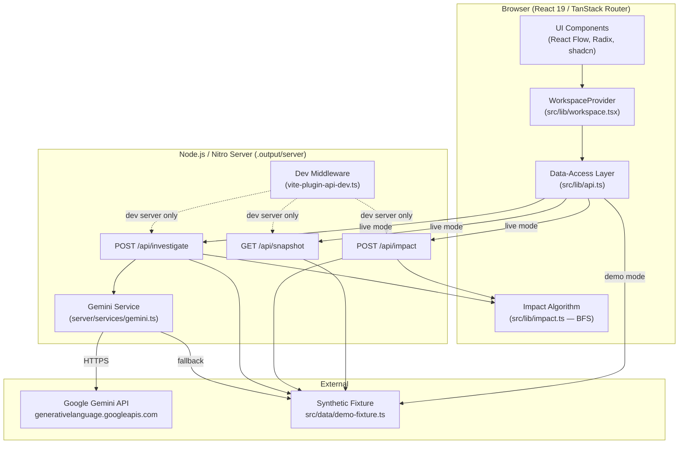
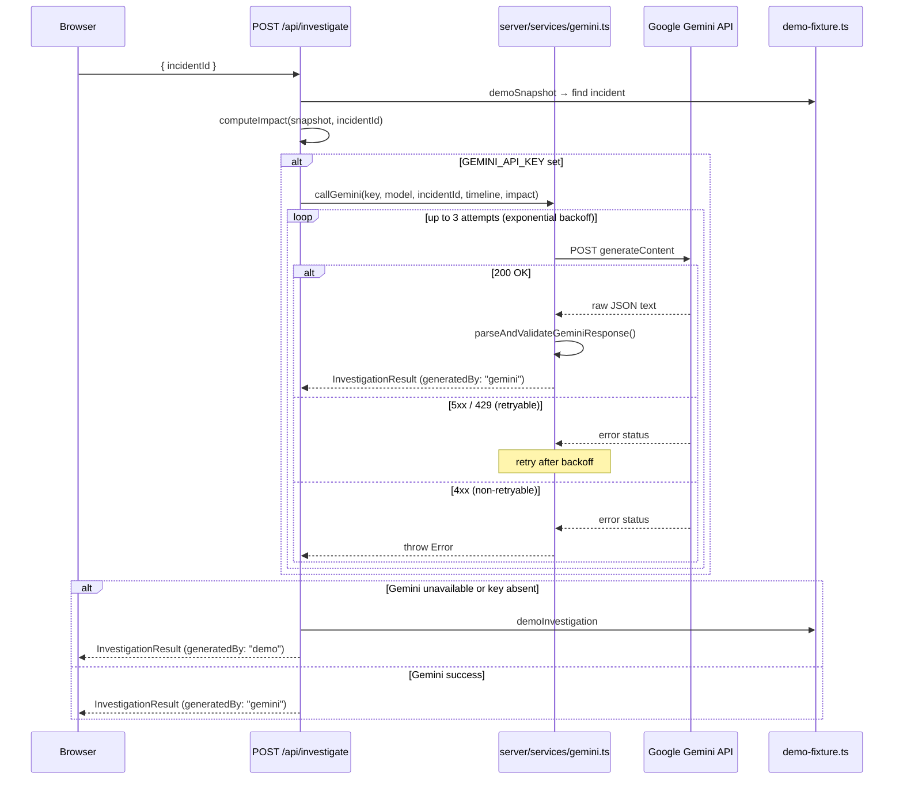

# ClusterMind — Architecture

## Overview

ClusterMind is a full-stack TypeScript application built on TanStack Start (Vite + Nitro). It provides an interactive Kubernetes topology graph, deterministic blast-radius analysis, and AI-assisted incident investigation via Google Gemini.

## Component Diagram



## Data Flow — Incident Investigation



## Module Responsibilities

| Module                      | Responsibility                                                  |
| --------------------------- | --------------------------------------------------------------- |
| `src/components/`           | React UI components — render only, no business logic            |
| `src/lib/api.ts`            | Client-side data-access (demo mode / live mode gate)            |
| `src/lib/impact.ts`         | Deterministic BFS blast-radius algorithm                        |
| `src/lib/types.ts`          | Shared TypeScript interfaces used by both client and server     |
| `src/lib/workspace.tsx`     | React context — shared UI state (selected incident, etc.)       |
| `src/data/demo-fixture.ts`  | Synthetic Kubernetes dataset (clearly labelled)                 |
| `server/api/*.ts`           | HTTP request validation; delegates to services                  |
| `server/services/gemini.ts` | Gemini API integration: prompt, retry, validation, fallback     |
| `vite-plugin-api-dev.ts`    | Dev-server middleware; delegates to same services as production |

## Environment Variable Scoping

```
Build time (Vite — baked into client bundle):
  VITE_DEMO_MODE        — enables/disables demo mode
  VITE_API_BASE_URL     — optional API origin override

Server runtime only (never reaches browser):
  GEMINI_API_KEY        — Gemini API key
  GEMINI_MODEL          — Gemini model name
  PORT                  — TCP listen port
```

## Security Properties

- `GEMINI_API_KEY` is never included in client bundles (no `VITE_` prefix).
- The Gemini prompt contains only incident timeline data from the synthetic fixture — never raw Kubernetes Secrets, credentials or sensitive logs.
- Evidence IDs in Gemini responses are validated against the fixture; hallucinated IDs are silently stripped.
- Demo fallback prevents user-visible errors when Gemini is unavailable.
